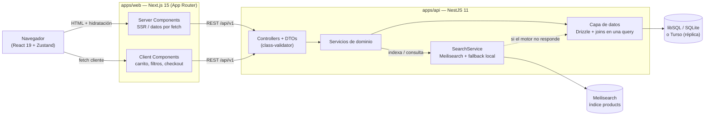

# Trato MarketPlace


Marketplace full-stack estilo Mercado Libre: catálogo con búsqueda tolerante a errores tipográficos, carrito, checkout, órdenes, reputación de vendedores, preguntas y respuestas, y panel de vendedor.

La persistencia corre sobre **SQLite/libSQL con Drizzle ORM**, con arquitectura preparada para **Turso** (base distribuida con réplicas embebidas) y **optimizada para baja latencia**.

Es un **proyecto de demostración de ingeniería**, no un comercio real: los pagos son simulados y las imágenes son SVG generados. No está afiliado a Mercado Libre.

---

## Tabla de contenidos

1. [Descripción general](#descripción-general)
2. [Stack tecnológico y decisiones](#stack-tecnológico-y-decisiones)
3. [Arquitectura](#arquitectura)
4. [Capa de datos: Drizzle + libSQL/Turso](#capa-de-datos-drizzle--libsqlturso)
5. [Latencia en Turso](#latencia-en-turso)
6. [Estructura del repositorio](#estructura-del-repositorio)
7. [Modelo de datos](#modelo-de-datos)
8. [Diseño del buscador](#diseño-del-buscador)
9. [Requisitos previos](#requisitos-previos)
10. [Puesta en marcha](#puesta-en-marcha)
11. [Variables de entorno](#variables-de-entorno)
12. [Scripts disponibles](#scripts-disponibles)
13. [Referencia de la API](#referencia-de-la-api)
14. [Frontend: rutas, renderizado y estado](#frontend-rutas-renderizado-y-estado)
15. [Autenticación y seguridad](#autenticación-y-seguridad)
16. [Verificación y QA](#verificación-y-qa)
17. [Notas de ingeniería](#notas-de-ingeniería)
18. [Convenciones](#convenciones)
19. [Limitaciones conocidas](#limitaciones-conocidas)
20. [Roadmap](#roadmap)
21. [Despliegue en producción (Vercel + Render)](#despliegue-en-producción-vercel--render)

---

## Descripción general

Trato cubre el ciclo completo de un marketplace de dos lados.

**Lado comprador**
- Home con banners rotativos, riel de categorías, beneficios, ofertas del día, productos destacados con pestañas (más vendidos / mejores valorados / nuevos ingresos), widgets laterales (medios de pago, mini-carrito, envíos, app) e historial "inspirado en lo que viste".
- Búsqueda con facetas (marca, condición, ubicación), filtros de precio, envío gratis y stock, orden configurable, paginación y sugerencias en vivo.
- Ficha de producto con galería con zoom, cuotas sin interés, stock, cantidad, reputación del vendedor, características, preguntas y respuestas, y opiniones con histograma.
- Carrito persistente, checkout (dirección, medios de pago, cuotas), historial de compras con estados y "volver a comprar".
- Favoritos que se sincronizan con la cuenta al iniciar sesión.

**Lado vendedor**
- Publicación de productos con categoría jerárquica, precio/oferta, stock, condición y atributos personalizados.
- Panel de cuenta: perfil, direcciones, publicaciones (pausar/reactivar) y ventas con transición de estado del envío.
- Respuesta a preguntas de compradores desde la propia ficha del producto.

**Plataforma**
- Búsqueda con **Meilisearch** y tolerancia a errores tipográficos (`samsumg` encuentra `Samsung`), con degradación automática a un buscador local si el motor no está disponible.
- Acceso a datos con **Drizzle ORM** sobre **libSQL**, con tres modos de conexión: archivo local, Turso remoto o **réplica embebida**.
- Seed determinista que genera un catálogo realista en español de Argentina.
- Tipos y contratos compartidos entre API y web, validación en el borde y OpenAPI generado.

---

## Stack tecnológico y decisiones

| Capa | Tecnología | Por qué |
|---|---|---|
| Frontend | **Next.js 15.5** (App Router) + **React 19** | SSR/SSG por ruta para SEO y primera carga, Server Components para datos y Client Components para interactividad. |
| Estilos | **Tailwind CSS v4** | Configuración CSS-first con `@theme`, sin `tailwind.config.js`, bundle mínimo. |
| Componentes UI | **shadcn/ui** (patrón copy-in sobre Radix) | Componentes accesibles y 100% personalizables sin atarse a una librería. |
| Animaciones | **Framer Motion 14** | Transiciones de página, hovers, rails con scroll suave y animaciones de layout en el carrito. |
| Estado de cliente | **Zustand 5** con `persist` | Carrito, favoritos, sesión, vistos, búsquedas recientes y ubicación, sin el boilerplate de Redux. |
| Backend | **NestJS 11** (TypeScript) | Monolito modular con inyección de dependencias, listo para extraer microservicios; un solo lenguaje y tipos compartidos con el frontend. |
| ORM | **Drizzle ORM 0.45** | SQL-first y tipado, sin capa de runtime pesada; permite **joins explícitos en una sola query** y SQL crudo cuando conviene, algo clave contra una base remota. |
| Base de datos | **libSQL** (`@libsql/client`) sobre **SQLite** local o **Turso** distribuido | Turso es SQLite gestionado con réplicas por región: lecturas a latencia de disco local y despliegue en minutos. |
| Migraciones | **drizzle-kit** | `push` para desarrollo y `generate` para versionar el DDL en SQL (aplicable a Turso con `turso db shell`). |
| API | **REST + OpenAPI/Swagger** | Caché y semántica HTTP natural para catálogo; documentación viva en `/api/docs`. |
| Búsqueda | **Meilisearch** | Open source, deploy en minutos, tolerancia a typos nativa, facetas y reglas de ranking personalizadas. |
| Contratos | **`@trato/shared`** (workspace) | Única fuente de verdad de tipos y constantes para API y web. |

### Decisiones y trade-offs

- **Drizzle en lugar de Prisma.** SQL-first: permite escribir **un `SELECT` con joins** para cada listado (Prisma emitía una query por nivel de `include`, es decir 3-4 round trips por ficha de producto contra una base remota). Además, Drizzle no impone un motor de consultas propio: podés bajar a SQL cuando hace falta, como en el recálculo de reputación o en el `UPDATE ... SET stock = stock - n` atómico del checkout.
- **libSQL/Turso en lugar de PostgreSQL.** El marketplace es de lectura intensiva y multi-región: la **réplica embebida** da lecturas locales y las escrituras van al primario. Sin Docker obligatorio para desarrollar (archivo local) y sin perder el camino a producción distribuida.
- **REST en lugar de GraphQL.** El catálogo se beneficia del caché HTTP y de URLs estables para SEO; GraphQL añadiría una capa de resolución que aquí no paga su costo.
- **Buscador con doble motor.** La API habla Meilisearch primero y cae a un buscador local (Levenshtein + scoring) cuando el motor no responde. La UI expone el motor activo (`engine: "meilisearch" | "local"`), de modo que degradar es observable y no silencioso.
- **Ranking delegado a Meilisearch.** El orden por relevancia, popularidad y rating vive en las `rankingRules` del índice, no en SQL: la base remota nunca se usa para ordenar/filtrar catálogo completo.
- **Imágenes generadas (SVG).** El seed genera ~1.200 SVG con gradientes y categorías, de modo que la demo funciona **offline** y sin depender de CDNs externos.
- **Dinero como enteros.** Todos los precios son `integer` en pesos argentinos, sin decimales: cero errores de punto flotante.

---

## Arquitectura



Flujos clave:

- **Lectura pública (catálogo):** `Server Component` → `GET /search` → `SearchService` → Meilisearch (o SQLite en modo local) → HTML renderizado en el servidor.
- **Escritura autenticada (publicar, comprar, opinar):** `Client Component` → `fetch` con `Bearer` → guard JWT → servicio → Drizzle → reindexado incremental en Meilisearch.
- **Degradación:** si Meilisearch no responde, `SearchService` conmuta a modo local y la búsqueda sigue funcionando con tolerancia a errores propia.

---

## Capa de datos: Drizzle + libSQL/Turso

### Tres modos de conexión (decididos por variables de entorno)

| Modo | `DATABASE_URL` | `TURSO_SYNC_URL` | Comportamiento |
|---|---|---|---|
| **Archivo local** (default) | `file:./db/trato.db` | vacío | SQLite en disco. Cero configuración, ideal para desarrollar. |
| **Turso remoto** | `libsql://<db>-<org>.turso.io` (o `https://…`) | vacío | Cada query viaja al primario. `libsql://` usa WebSocket persistente; `https://` es HTTP puro (sin handshake, ideal serverless). |
| **Réplica embebida** | `file:./db/replica.db` | `libsql://<db>-<org>.turso.io` | **Lecturas al disco local**; las escrituras se reenvían al primario. Requiere filesystem persistente (contenedor/VM), no serverless. |

`src/db/client.ts` resuelve el modo y crea el cliente; `src/config.ts` expone `databaseMode()`; `GET /health` reporta `databaseMode`, `replicaUrl` y la **latencia del probe** en milisegundos.

### Cómo se accede a los datos

- **Un `SELECT` con joins por listado.** `src/db/queries/products.ts` expone `productSelection(db)`, que trae producto + vendedor + categoría + padre + abuelo en **una sola query** (con `alias()` para los self-joins del árbol de categorías). Todos los listados y la ficha de producto lo reutilizan.
- **Sin N+1 en órdenes.** `myOrders` y `sales` traen órdenes y luego sus ítems con un `inArray` y agrupan en memoria: 2 queries, no 2×N.
- **Batch en vez de transacción interactiva.** El checkout usa `db.batch([...])` (insert de orden + ítems + `UPDATE products SET stock = stock - n, sold_quantity = sold_quantity + n`). Es **atómico y compatible con el protocolo HTTP de Turso**, que no soporta transacciones interactivas.
- **Agregaciones en SQL.** El recálculo de reputación y de favoritos usa `UPDATE ... SET x = (SELECT COUNT(*) …)` y `AVG()` en una sola sentencia, en lugar de cientos de updates desde la app.
- **Consistencia de réplica.** Tras operaciones de escritura (`checkout`, pausar/republicar, opinar, favoritos) el servicio llama a `db.sync()` cuando está en modo réplica, garantizando "leer lo que escribí".

### Migraciones y esquema

```bash
npm run db:push        # aplica el esquema al archivo local (desarrollo)
npm run db:generate    # genera SQL versionado en apps/api/drizzle/0000_*.sql
npm run db:studio      # explorador visual
```

Para Turso, el DDL generado se aplica con la CLI oficial:

```bash
turso db shell <nombre-db> < apps/api/drizzle/0000_ambiguous_lizard.sql
```

(o `drizzle-kit migrate`, que usa la misma configuración cambiando el dialecto automáticamente cuando `TURSO_AUTH_TOKEN` está presente).

---

## Latencia en Turso

Estado de cada técnica en este repositorio.

**Implementado**

| Técnica | Dónde |
|---|---|
| Réplica embebida con `syncUrl` + `syncInterval` configurables | `src/db/client.ts`, `src/config.ts` |
| `sync()` tras escrituras para lectura consistente | `DbService.sync()` invocado en checkout, publicaciones, opiniones y favoritos |
| **Un join por request** en lugar de N queries por `include` | `src/db/queries/products.ts` |
| Batch atómico en checkout (1 round trip para N escrituras) | `orders.service.ts` |
| Índices compuestos alineados a las queries calientes | `schema.ts`: `(status, category_id, sold_quantity)`, `(status, created_at)`, `(status, rating)`, `(status, price)`, `(user_id, created_at)`, `(product_id, created_at)` |
| Escrituras como expresiones SQL atómicas (sin read-modify-write) | `sql\`${products.stock} - ${qty}\`` en checkout |
| Búsqueda y facetas fuera de SQL (delegadas a Meilisearch) | `SearchService` |
| Ranking de relevancia/popularidad en el índice, no en la DB | `RANKING_RULES` (`soldQuantity:desc`, `rating:desc`) |
| Cliente único por proceso (nunca por request) | `DbService` singleton por DI de Nest |
| Probe de latencia observable | `GET /health` → `latencyMs` |
| Protocolo elegible según despliegue | `libsql://` (WS, servidor long-running) vs `https://` (HTTP, serverless) |

**Pendiente (documentado como próximo paso)**

| Técnica | Impacto esperado |
|---|---|
| `select` recortado para listados (hoy se traen `description` y `attributes` completos) | Menos egress y CPU en cada listado. |
| ISR/`revalidate` en las páginas de catálogo (hoy `cache: "no-store"`) | Menos requests a la API y a la base; multiplica el efecto de la réplica. |
| Keyset pagination en lugar de `skip` en páginas profundas | Evita recorrer filas descartadas. |
| Desnormalizar `sellerName`/`sellerStatus`/`location` en `products` | Elimina el join con `users` en listados. |
| Caché de la home y de facetas (Redis o caché en proceso) | Corta las 8 queries del payload de home. |
| Prohibir el buscador local por `LIKE '%x%'` en producción | Evita full scans cuando Meilisearch no está. |

---

## Estructura del repositorio

```
Trato MarketPlace/
├─ package.json                 # workspaces + scripts orquestadores (concurrently)
├─ docker-compose.yml           # Meilisearch (opcional)
├─ .env.example                 # documentación de variables de entorno
├─ packages/
│  └─ shared/                   # @trato/shared — tipos y constantes compartidas
│     └─ src/{types,constants,index}.ts
└─ apps/
   ├─ api/                      # @trato/api — NestJS 11 + Drizzle
   │  ├─ drizzle.config.ts      # dialecto sqlite/turso según entorno
   │  ├─ db/                    # archivo local de libSQL (gitignored)
   │  ├─ drizzle/               # migraciones SQL versionadas
   │  ├─ scripts/reindex.ts     # CLI de reindexado
   │  └─ src/
   │     ├─ main.ts             # bootstrap, prefijo /api/v1, Swagger, pipes, CORS
   │     ├─ config.ts           # env tipado + databaseMode()
   │     ├─ common/             # guard JWT, decorador CurrentUser, slugify
   │     ├─ db/
   │     │  ├─ schema.ts        # 9 tablas + índices compuestos
   │     │  ├─ client.ts        # resolución de modo (archivo/remoto/réplica)
   │     │  ├─ db.service.ts    # cliente + drizzle + ping/sync (singleton)
   │     │  ├─ mappers.ts       # fila con joins → DTO de la API
   │     │  ├─ queries/products.ts   # select con joins en una query
   │     │  ├─ meili-sync.ts    # indexado compartido (seed + CLI)
   │     │  └─ seed/            # seed.ts + seed-data.ts + images.ts
   │     ├─ health/             # /health con modo de DB y latencia
   │     └─ modules/
   │        ├─ auth/            # registro, login, /me (JWT)
   │        ├─ users/           # perfil y direcciones
   │        ├─ categories/      # árbol de categorías
   │        ├─ products/        # CRUD, relacionados, publicaciones del vendedor
   │        ├─ search/          # Meilisearch + fallback local + facets + sugerencias
   │        ├─ orders/          # checkout (batch), compras, ventas, estados
   │        ├─ questions/       # preguntas y respuestas
   │        ├─ reviews/         # opiniones + recálculo de reputación
   │        ├─ favorites/       # favoritos y sincronización
   │        └─ home/            # payload de la home
   └─ web/                      # @trato/web — Next.js 15
      ├─ next.config.ts         # transpilePackages: ["@trato/shared"]
      └─ src/
         ├─ app/                # rutas del App Router
         ├─ components/         # ui (22 primitivas), layout, home, product, search, cart, account, auth
         ├─ store/              # 6 stores de Zustand (persist)
         ├─ hooks/              # useMounted, useDebouncedValue, useOnClickOutside, favoritos
         └─ lib/                # cliente de API, utilidades, parámetros de búsqueda
```

---

## Modelo de datos

Nueve tablas en `apps/api/src/db/schema.ts`, definidas con `drizzle-orm/sqlite-core`:

| Tabla | Rol | Detalles |
|---|---|---|
| `users` | Compradores y vendedores | Incluye atributos de vendedor (`seller_name`, `seller_status`, `seller_sales`, `seller_rating`, `location`, `member_since`). |
| `addresses` | Direcciones de envío | `is_default`; borrado en cascada con el usuario. |
| `categories` | Árbol de categorías | Self-FK `parent_id` con `level` y `order` (14 raíces + 53 subcategorías). |
| `products` | Publicación | Precio y precio original `integer` (ARS); `images` y `attributes` como columnas JSON; `status` con pausa lógica. 8 índices, incluidos los compuestos `(status, category_id, sold_quantity)`, `(status, created_at)`, `(status, rating)`, `(status, price)`. |
| `orders` / `order_items` | Pedidos | El ítem guarda *snapshot* (título, precio, imagen, vendedor) para que el historial no mute. |
| `reviews` | Opiniones | `unique(product_id, user_id)`: una opinión por usuario y producto, con `onConflictDoUpdate`. |
| `questions` | Preguntas | `answer` + `answered_at`; responder está restringido al vendedor del producto. |
| `favorites` | Favoritos | `unique(user_id, product_id)` + `onConflictDoNothing` para idempotencia. |

Convenciones del esquema (elegidas pensando en Turso):

- **IDs UUID v4** generados en la app (`crypto.randomUUID()`), no dependientes de una secuencia del servidor.
- **Columnas `snake_case`** y claves TypeScript en `camelCase`: SQL legible sin perder ergonomía.
- **Timestamps como `integer` epoch ms** (`mode: "timestamp_ms"`): comparables y ordenables, y se serializan a ISO en los mappers.
- **Booleanos como `integer` 0/1** (`mode: "boolean"`) y **JSON como texto** (`mode: "json"`), que Drizzle serializa/deserializa automáticamente.
- **Sin enums** (no existen en SQLite): se usan `string` con validación en los DTO y constantes en `@trato/shared`.

---

## Diseño del buscador

`SearchService` (`apps/api/src/modules/search/`) implementa dos motores tras la misma interfaz.

**Documento indexado** (`buildProductDocument`, compartido por API, seed y CLI).

**Configuración del índice**

| Ajuste | Valor |
|---|---|
| `searchableAttributes` | `title`, `brand`, `description`, `categoryName`, `sellerName` |
| `filterableAttributes` | `categoryPath`, `categorySlug`, `condition`, `brand`, `location`, `freeShipping`, `price`, `sellerId`, `discount` |
| `sortableAttributes` | `price`, `soldQuantity`, `rating`, `createdAt`, `discount` |
| `rankingRules` | las 7 por defecto + **`soldQuantity:desc`** + **`rating:desc`** (desempate por popularidad y reputación) |
| `facets` | `brand`, `condition`, `location` |
| `synonyms` | 16 entradas: `notebook → laptop/laptops/computadora`, `celular → smartphone/telefono`, `heladera → refrigerador/nevera`, … |
| `primaryKey` | `id` (explícito: hay `categoryId`, `sellerId` e `id`, y la inferencia falla) |

**Contrato de búsqueda.** `GET /search` acepta `q`, `category`, `minPrice`, `maxPrice`, `condition`, `brand[]`, `location`, `freeShipping`, `inStock`, `sort` y paginación. Devuelve hits, totales, facetas con contadores y el motor usado (`engine`) junto al tiempo (`tookMs`).

**Buscador local (fallback).** Cuando `MEILISEARCH_URL` está vacío o el motor no responde: filtra candidatos con Drizzle (categoría y descendientes, precio, condición, marca, ubicación, stock), los puntúa en memoria (coincidencia en título > prefijo > Levenshtein dentro de tolerancia > marca > descripción, con boost por ventas, rating y envío gratis) y reconstruye facetas.

**Indexado.** `POST /search/reindex` reconstruye el índice completo; `npm run search:reindex` hace lo mismo por CLI; y `create/update/pause` de producto más el `checkout` reindexan **solo los documentos afectados**.

---

## Requisitos previos

| Requisito | Versión | Notas |
|---|---|---|
| Node.js | >= 20 (validado en 24.16) | |
| npm | >= 10 (validado en 11.13) | El repo usa **npm workspaces** (no requiere pnpm/yarn). |
| Meilisearch | opcional | Sin él la búsqueda funciona en modo local. El binario de Windows ya está en `tools/`. |
| Turso CLI | opcional | Solo para usar Turso remoto o réplicas. |
| Docker | opcional | Solo para levantar Meilisearch en contenedor. |

---

## Puesta en marcha

### Camino rápido (sin nube, sin Docker)

```bash
npm install          # instala workspaces y compila @trato/shared
npm run db:push      # crea apps/api/db/trato.db y aplica el esquema
npm run seed         # 370 productos, 67 categorías, 19 usuarios, opiniones, preguntas, órdenes
npm run dev          # API en :4000 y Web en :3000 en modo watch
```

Abrí http://localhost:3000. La búsqueda funciona en modo local (con tolerancia a typos).

### Con Meilisearch real

```bash
npm run search:serve   # tools/meilisearch.exe en 127.0.0.1:7700 (Windows)
npm run search:reindex # indexa el catálogo actual
npm run dev
```

Verificá el motor activo con `GET http://localhost:4000/api/v1/health`.

### Con Turso remoto

```bash
# 1) Crear la base y obtener credenciales
turso db create trato
turso db show trato --url          # libsql://trato-<org>.turso.io
turso db tokens create trato       # token

# 2) Configurar apps/api/.env
#    DATABASE_URL="libsql://trato-<org>.turso.io"
#    TURSO_AUTH_TOKEN="<token>"
#    (dejar TURSO_SYNC_URL vacío)

# 3) Aplicar el esquema y cargar datos
turso db shell trato < apps/api/drizzle/0000_ambiguous_lizard.sql
npm run seed
```

### Con réplica embebida (producción recomendada)

```bash
# DATABASE_URL="file:./db/replica.db"      # archivo local de la réplica
# TURSO_SYNC_URL="libsql://trato-<org>.turso.io"
# TURSO_AUTH_TOKEN="<token>"
# TURSO_SYNC_INTERVAL=60000                # ms entre sincronizaciones
npm run db:push     # crea la réplica local
npm run seed
npm start
```

Las lecturas salen del archivo local; las escrituras van al primario y `db.sync()` refresca la réplica después de cada operación de escritura.

### Modo producción

```bash
npm run build                        # shared → api → web
npm start                            # API (node dist/main.js)
npm run start -w @trato/web          # Web (next start)
```

### Credenciales de demostración

| Rol | Email | Contraseña |
|---|---|---|
| Comprador (con compras y favoritos) | `demo@trato.com` | `Demo1234` |
| Compradores | `lucia@`, `carlos@`, `sofi@`, `javier@trato.com` | `Demo1234` |
| Vendedores | `ventas@tecnoshop.com`, `hola@celumundo.com`, `pedidos@houseelectro.com`, … | `Demo1234` |

---

## Variables de entorno

**`apps/api/.env`**

| Variable | Default | Descripción |
|---|---|---|
| `DATABASE_URL` | `file:./db/trato.db` | URL de libSQL: `file:…`, `libsql://…` o `https://…`. |
| `TURSO_AUTH_TOKEN` | vacío | Token de Turso. Su ausencia implica modo archivo local. |
| `TURSO_SYNC_URL` | vacío | Si está presente, la API corre en **modo réplica embebida**. |
| `TURSO_SYNC_INTERVAL` | `60000` | Intervalo de sincronización de la réplica (ms). |
| `JWT_SECRET` | valor de dev | **Cambiar en producción.** |
| `JWT_EXPIRES_IN` | `7d` | Vigencia del token. |
| `PORT` | `4000` | Puerto de la API. |
| `MEILISEARCH_URL` | vacío | Vacío ⇒ buscador local. Ej.: `http://127.0.0.1:7700`. |
| `MEILISEARCH_MASTER_KEY` | vacío | Debe coincidir con el motor. |
| `WEB_ORIGIN` | `http://localhost:3000` | Origen permitido por CORS. |

**`apps/web/.env.local`**

| Variable | Default | Descripción |
|---|---|---|
| `NEXT_PUBLIC_API_URL` | `http://localhost:4000/api/v1` | Base de la API usada por SSR y por el cliente. |

---

## Scripts disponibles

| Script | Acción |
|---|---|
| `npm run dev` | API + Web en watch (concurrently). |
| `npm run dev:api` / `npm run dev:web` | Solo un servicio. |
| `npm run build` | Compila `@trato/shared` → `@trato/api` → `@trato/web` en orden. |
| `npm start` | API en modo producción. |
| `npm run start -w @trato/web` | Web en modo producción. |
| `npm run db:push` | Aplica el esquema Drizzle a la base configurada. |
| `npm run db:generate` | Genera SQL versionado en `apps/api/drizzle/`. |
| `npm run db:studio` | Explorador visual de la base. |
| `npm run db:reset` | Borra la base local, reaplica el esquema y siembra. |
| `npm run seed` | Repuebla (determinista) y reindexa si hay Meilisearch. |
| `npm run search:reindex` | Reconstruye el índice sin pasar por la API. |
| `npm run search:serve` | Levanta Meilisearch local (Windows, binario en `tools/`). |

---

## Referencia de la API

Prefijo global: `/api/v1` · Documentación interactiva: **`/api/docs`** · Autenticación: `Authorization: Bearer <token>`.

| Método | Ruta | Auth | Descripción |
|---|---|---|---|
| GET | `/health` | — | Estado de la DB (modo y latencia) y del motor de búsqueda. |
| POST | `/auth/register` | — | Alta de usuario; devuelve `{ token, user }`. |
| POST | `/auth/login` | — | Login; devuelve `{ token, user }`. |
| GET | `/auth/me` | Sí | Usuario de la sesión. |
| GET | `/home` | — | Payload de la home (banners, categorías, ofertas, más vendidos, mejores valorados, novedades, estadísticas). |
| GET | `/categories` | — | Árbol de categorías con hijos. |
| GET | `/categories/all` | — | Lista plana (para selects). |
| GET | `/categories/:slug` | — | Categoría con hijos y cadena de ancestros. |
| GET | `/categories/:slug/ancestors` | — | Breadcrumb. |
| GET | `/search` | — | Búsqueda con filtros, facetas, orden y paginación. |
| GET | `/search/suggestions?q=` | — | Autocompletado de títulos. |
| POST | `/search/reindex` | Sí | Reconstruye el índice de Meilisearch. |
| GET | `/products/:param` | — | Detalle por `slug` o `id` (incrementa visitas). |
| GET | `/products/:id/related` | — | Productos similares. |
| GET | `/products/:id/questions` | — | Preguntas del producto. |
| GET | `/products/:id/reviews` | — | Opiniones + resumen e histograma. |
| GET | `/products/mine` | Sí | Publicaciones del vendedor autenticado. |
| GET | `/sellers/:id/products` | — | Catálogo de un vendedor. |
| POST | `/products` | Sí | Publicar producto. |
| PATCH | `/products/:id` | Sí | Editar (solo el vendedor). |
| PUT | `/products/:id/pause` | Sí | Pausar/reactivar (alterna estado y sincroniza el índice). |
| POST | `/questions` | Sí | Preguntar. |
| POST | `/questions/:id/answer` | Sí | Responder (solo el vendedor del producto). |
| POST | `/reviews` | Sí | Opinar / actualizar opinión (upsert). |
| POST | `/orders/checkout` | Sí | Crear pedido desde ítems del carrito (batch atómico). |
| GET | `/orders` | Sí | Mis compras. |
| GET | `/orders/sales` | Sí | Mis ventas. |
| GET | `/orders/:id` | Sí | Detalle (comprador o vendedor del pedido). |
| PUT | `/orders/:id/status` | Sí | Avanzar estado del envío (solo vendedor). |
| GET | `/users/me` | Sí | Perfil. |
| PATCH | `/users/me` | Sí | Editar perfil. |
| GET/POST | `/users/me/addresses` | Sí | Listar / crear direcciones. |
| DELETE | `/users/me/addresses/:id` | Sí | Eliminar dirección. |
| PUT | `/users/me/addresses/:id/default` | Sí | Marcar como predeterminada. |
| GET | `/favorites` | Sí | Mis favoritos. |
| POST | `/favorites` | Sí | Agregar (idempotente). |
| POST | `/favorites/sync` | Sí | Sincronizar favoritos locales al iniciar sesión. |
| DELETE | `/favorites/:productId` | Sí | Quitar. |

```bash
curl "http://localhost:4000/api/v1/search?q=samsumg&sort=price_asc&perPage=5"
curl -X POST http://localhost:4000/api/v1/auth/login \
  -H "Content-Type: application/json" \
  -d '{"email":"demo@trato.com","password":"Demo1234"}'
```

---

## Frontend: rutas, renderizado y estado

| Ruta | Nombre | Renderizado | Estrategia de datos |
|---|---|---|---|
| `/` | Home | `ƒ` dinámico | SSR: `fetch /home` con `cache: "no-store"`. |
| `/buscar` | Resultados | `ƒ` dinámico | SSR: lee `searchParams` y consulta `/search`. |
| `/categorias/[slug]` | Categoría | `ƒ` dinámico | SSR en paralelo: categoría + búsqueda filtrada. |
| `/productos/[slug]` | Detalle | `ƒ` dinámico | SSR en paralelo: producto, opiniones, preguntas, relacionados, vendedor, categoría. `generateMetadata` para SEO/OG. |
| `/carrito` | Carrito | `○` estático | Estado local (Zustand + localStorage). |
| `/checkout` | Checkout | `○` estático | Estado local + `POST /orders/checkout`. |
| `/mis-compras` | Mis compras | `○` estático | Fetch cliente autenticado. |
| `/mis-favoritos` | Favoritos | `○` estático | Store local sincronizado con el servidor. |
| `/mi-cuenta` | Panel | `○` estático | Tabs: perfil, direcciones, publicaciones, ventas. |
| `/vender` | Publicar | `○` estático | Fetch cliente (categorías) + `POST /products`. |
| `/ingresar`, `/registro` | Auth | `○` estático | Login/registro + sincronización de favoritos. |
| `not-found`, `error`, `loading`, `template` | Infraestructura | — | 404, error boundary, skeletons y transición de página. |

Las páginas `○` se prerenderizan como shell y resuelven la sesión en el cliente (los stores usan `useMounted` para evitar desajustes de hidratación).

**Estado del cliente** (`apps/web/src/store/`): `cart-store` (`trato-cart`), `favorites-store` (`trato-favorites`), `auth-store` (`trato-auth`), `recent-store` (`trato-recent`), `search-store` (`trato-searches`), `location-store` (`trato-location`).

**Home adaptada a la maqueta de diseño:** header navy con sub-nav (menú "Todas las categorías", selector de ubicación), layout de tres columnas (riel de categorías + contenido + widgets), hero con collage de productos y flechas, sección de ofertas, pestañas de destacados con tarjeta compacta y widgets de medios de pago, mini-carrito, envíos y app.

---

## Autenticación y seguridad

- **Hashing:** `bcryptjs` con 10 rondas.
- **Tokens:** JWT HS256 (`@nestjs/jwt`), expiración de 7 días, `sub` = id de usuario. El módulo se registra como **global** para que el guard resuelva `JwtService` en todos los módulos.
- **Guard:** `JwtAuthGuard` propio (sin Passport): valida el header, verifica el token, recarga el usuario y lo inyecta vía `@CurrentUser()`.
- **Nunca se expone la contraseña:** el tipo `SafeUser` (`Omit<UserRow, "password">`) atraviesa el guard y las respuestas.
- **Validación en el borde:** `ValidationPipe` con `whitelist`, `forbidNonWhitelisted` y conversión implícita; DTOs con `class-validator` (mensajes en español).
- **Autorización por recurso:** editar/pausar producto, responder pregunta y cambiar estado de envío verifican la propiedad y responden `403`.
- **Integridad de compra:** el checkout valida existencia, estado y stock antes de escribir, y descuenta stock de forma atómica.
- **CORS:** restringido a `WEB_ORIGIN` y `localhost:3000`.

**Fuera de alcance (a propósito, es una demo):** rate limiting, verificación de email, recuperación de contraseña, refresh tokens y CSRF/cookies `httpOnly`. El token se guarda en `localStorage`, aceptable para una demo pero sujeto a XSS en producción real.

---

## Verificación y QA

Todo se validó ejecutando el sistema real.

```powershell
# Estado de la base y del motor
Invoke-RestMethod http://localhost:4000/api/v1/health
# → database: ok · databaseMode: file · latencyMs: 1 · searchEngine: meilisearch

# Tolerancia a errores tipográficos
Invoke-RestMethod "http://localhost:4000/api/v1/search?q=samsumg&perPage=3"
# → total 21 en 5 ms · top: "Samsung Smart TV Crystal UHD 4K 55\" (3549 vendidos)"

# Filtros, facetas y orden
Invoke-RestMethod "http://localhost:4000/api/v1/search?brand=Lenovo&perPage=3"
Invoke-RestMethod "http://localhost:4000/api/v1/search?q=zapatillas&freeShipping=1&sort=price_asc"

# Checkout autenticado (batch + stock atómico)
# → orden TR-XXXX · stock 30 → 28 · sold_quantity 2329 → 2331 · aparece en "Mis compras"
```

Resultados observados:

| Verificación | Resultado |
|---|---|
| `nest build` / `next build` | sin errores de tipos; 14 rutas, 103 kB shared JS |
| `drizzle-kit push` | 9 tablas, 22 índices, 15 FKs |
| Seed | 19 usuarios · 67 categorías · 370 productos · 963 opiniones · 356 preguntas · 18 órdenes · 20 favoritos |
| Índice Meilisearch | 370 documentos, `engine: meilisearch` |
| Ranking personalizado | `soldQuantity:desc`, `rating:desc` aplicadas en el índice |
| Búsqueda con typos | `samsumg` → 21 resultados en 5 ms, todos Samsung ordenados por ventas |
| Checkout | batch atómico, stock descontado, visible en mis compras |
| Publicar producto | aparece en el índice al instante; al pausar desaparece |
| Validaciones | carrito vacío, falta de token y cantidad fuera de rango devuelven mensajes claros |
| SSR | home, búsqueda, categoría, detalle, carrito, checkout y favoritos responden con contenido esperado |
| Imágenes | SVG servidos con HTTP 200 |

---

## Notas de ingeniería

Trampas reales encontradas durante la migración a Drizzle/libSQL, y cómo se resolvieron.

| Síntoma | Causa raíz | Corrección |
|---|---|---|
| `TS1479: The current file is a CommonJS module … the referenced file is an ECMAScript module` | `@libsql/client` y `meilisearch` son ESM puros y el build de Nest es CommonJS | Carga diferida con `await import()` en lugar de import estático |
| `TS1541: Type-only import of an ECMAScript module … must have a 'resolution-mode' attribute` | Los tipos de un paquete ESM no se pueden importar por tipo desde CJS sin declarar el modo | `import("@libsql/client", { with: { "resolution-mode": "import" } }).Client` |
| La base no se podía inicializar en el constructor | `createClient` sólo existe del lado ESM | `onModuleInit` asíncrono en `DbService`, con getters que fallan si se usan antes |
| `SQL<unknown>` no es aceptado por `client.execute` | Se pasaba un objeto SQL de Drizzle a la API cruda de libSQL | `client.execute("select 1")` para el probe, `db.run(sql\`…\`)` para SQL de Drizzle |
| `addressSnapshot` no coincidía con el tipo de la columna JSON | El DTO tiene `phone` opcional y la columna lo exige `string \| null` | Normalizar en el servicio: `{ ...dto.address, phone: dto.address.phone ?? null }` |
| Documentos no se indexaban (`index_primary_key_multiple_candidates_found`) | Meilisearch no puede inferir la PK con `categoryId`, `sellerId` e `id` | `addDocuments(docs, { primaryKey: "id" })` |
| `samsumg` devolvía un cargador como primer resultado | Sin reglas de ranking personalizadas, el desempate era arbitrario | Añadir `soldQuantity:desc` y `rating:desc` a las `rankingRules` |
| `prisma migrate dev` colgaba esperando input | Prompt interactivo de nombre de migración | Reemplazado por `drizzle-kit push --force` (determinista) y `db:generate` para versionar |

---

## Convenciones

- **Contratos primero:** toda estructura que cruce la frontera API/web vive en `@trato/shared`.
- **Validación en el borde:** todo input externo pasa por un DTO con `class-validator`; los servicios asumen datos válidos.
- **Mappers explícitos:** las filas de la base no se filtran a la API; `src/db/mappers.ts` construye los DTO (fechas ISO, categoría encadenada, cuotas, descuento).
- **Acceso a datos centralizado:** las queries repetidas (producto con vendedor y categoría) viven en `src/db/queries/`, no dispersas en servicios.
- **Errores con semántica HTTP:** 404, 403, 409, 400 con mensajes accionables en español.
- **TypeScript estricto en la web** (`strict: true`); la API mantiene los defaults de Nest.
- **UI en español (es-AR)** con formato `Intl` para moneda y fechas.
- **Código sin comentarios explicativos:** la intención se expresa en nombres, tipos y este documento.

---

## Limitaciones conocidas

- Pagos simulados: ninguna tarjeta se cobra realmente.
- Imágenes generadas como SVG; falta subida de archivos.
- Sin mensajería directa comprador-vendedor (solo preguntas públicas).
- Sin tests automatizados todavía (ver Roadmap).
- Las opiniones no verifican una compra previa.
- El buscador local es funcional pero no reemplaza el ranking de Meilisearch; y su `LIKE '%x%'` es un full scan (no apto para producción).
- Escritor único en el primario de Turso: picos de checkout serializan.
- Warnings cosméticos de Next (`metadataBase`).

---

## Roadmap

**Corto plazo**
- Suite de tests: unitarios (scorer local, mappers) y e2e con Supertest y Playwright.
- Las optimizaciones de latencia pendientes: `select` recortado, ISR, keyset pagination, desnormalización del vendedor, caché de home/facetas.
- Subida real de imágenes (S3/MinIO) y rate limiting.

**Mediano plazo**
- Pasarela de pago real (MercadoPago) con webhooks y estados de pago.
- Mensajería comprador-vendedor y notificaciones en tiempo real.
- Dockerfiles, CI/CD con `drizzle-kit migrate` + reindexado automático.
- Multi-región con réplicas embebidas por zona y métricas de latencia por región.

**Largo plazo**
- Extracción de microservicios (búsqueda y checkout primero), manteniendo NestJS como monolito modular.
- Multi-moneda/multi-país con `@trato/shared` como contrato i18n.
- Recomendaciones personalizadas sobre eventos de navegación.

---

## Despliegue en producción (Vercel + Render)

El repo es auto-contenido: nada de lo que corre en tu máquina — la base local (`apps/api/db/`), los `.env`, el binario de Meilisearch (`tools/*.exe`, `tools/meili-data/`), ni los builds (`dist/`, `.next/`) — llega a Git; está todo en `.gitignore`. Lo único que hay que subir es el código fuente, el `package-lock.json` y el SQL versionado en `apps/api/drizzle/`.

Stack de despliegue recomendado:

| Pieza | Plataforma | Artefacto |
|---|---|---|
| Web (Next.js 15, SSR) | Vercel | `apps/web/vercel.json` (instala y compila el monorepo con Root Directory `apps/web`). |
| API (NestJS 11) | Render | `render.yaml` (Blueprint de infraestructura como código: servicio `trato-api` y `trato-web` opcional). |
| Base de datos | Turso | `libsql://<db>-<org>.turso.io` (o réplica embebida en host con disco persistente). |
| Buscador | Meilisearch Cloud | `MEILISEARCH_URL` + `MEILISEARCH_MASTER_KEY`. |

Los builds son standalone por workspace: cada `apps/*/package.json` tiene un `prebuild` que compila `@trato/shared`, y la raíz corre `prepare` durante `npm install`. No hay pasos manuales ni ficheros externos al repo.

El paso a paso completo (crear la base en Turso, aplicar el DDL versionado, seed desde local contra la nube, levantar Meilisearch Cloud, configurar Render y Vercel, reindexar y verificar) está en **[DEPLOY.md](./DEPLOY.md)**.

---

<sub>Proyecto de demostración con fines de portafolio técnico. Tecnologías: Next.js, React, NestJS, Drizzle ORM, libSQL/Turso, Tailwind CSS, Framer Motion, Zustand y Meilisearch. No afiliado a Mercado Libre.</sub>
